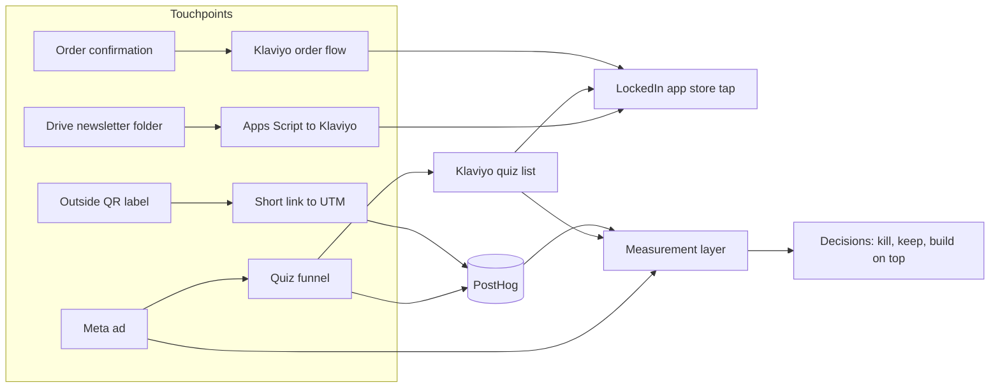

# systems

Growth systems

Summit Kabir  · summitkabir6@gmail.com

I'm the COO of Gym Army, a direct-to-consumer fitness brand running cross-border supply chain between China, Canada and the US. I lead GTM and product at LockedIn, a workout and accountability app. I built every system below myself.

These systems turn raw traffic and customer data into reliable, measurable growth loops — automation, segmentation, multi-tool orchestration, and the measurement layer that tells me which numbers I can trust.

This repo is about the systems, not a scorecard. Each system has four parts: how it runs, what it produced, what broke, and how I measure behaviour so I can build on top of it.

**Tools:** Apps Script, Python, SQL, Klaviyo, Shopify, PostHog, Meta ads, Lovable.

## What's proprietary, and why

At Gym Army I make the call to publish architecture and aggregated outputs. Nothing here contains customer emails or names, order-level data, supplier terms, or margins. Numbers are dated as of October 29, 2026.

## The systems

| # | System | What it does | Volume (as of 29 Oct 2026) |
| --- | --- | --- | --- |
| 01 | [Email automation and consent gates](01-email-automation) | Daily newsletter from a Google Drive folder into Klaviyo, plus reactivation sends with consent and deliverability gates | 8,531 profiles in the newsletter segment. About 6,800 EN and 990 FR recipients per issue. Issues 1–4 measured. Reactivation program: roughly 8,400 sends in total. |
| 02 | [Paid quiz funnel](02-paid-quiz-funnel) | Meta ads to a 36-screen quiz, email capture, Klaviyo nurture, then App Store and Google Play taps, all tracked in PostHog | 534 quiz starts, 388 completed results, 313 email captures, 116 store taps (29 Sep–29 Oct) |
| 03 | [Order and QR touchpoints](03-order-and-qr-touchpoints) | LockedIn block in every order confirmation (Shopify plus Klaviyo), and three QR codes on outside shipment labels with short-link to UTM to PostHog attribution | LockedIn block on every order confirmation. QR: about 160 boxes, 119 scans and 65 downloads across 3 labels in about 1.5 months. |
| 04 | [Measurement layer](04-measurement-layer) | The event taxonomy, UTM conventions, source-of-truth rules and reconciliation that let me trust (or distrust) the numbers above | 3 platforms reconciled (Meta, PostHog, Klaviyo). 4 known reconciliation gaps documented. |

## How the systems connect

## What I'd tell a reviewer first

Early sends started as broad mass sends and converted weakly until I segmented by niche and added form-based self-identification. The pattern that fixed it, one source of truth, hygiene rules and a recorded decision for every number, is the same pattern I'd bring to outbound: a defined ICP, enrichment I can audit, and a pipeline where every stage has an owner and a rule.

I sent reactivation campaigns to exhausted lists after a stop recommendation. Those numbers are in the repo because I'd rather you see the cost than trust a polished story.

Attribution is still the weak point. There is no reliable link from an order back to the specific touchpoint that produced it, and the same gap exists in outbound between a sourced contact and a closed deal. Closing it is what makes cost per qualified opportunity measurable instead of estimated.

## What I would build first for outbound

An ICP definition in data rather than prose: firmographics, which ERP they run, spend profile, and the disqualifiers that stop a rep wasting a week. Enrichment and routing, where sourced accounts are enriched, scored and routed, with a named human approving anything automated before it sends. Sequences that are actually personalized, with the personalization logged so I can tell which variable did the work. Agents that stay in propose mode until acceptance rate justifies auto mode, each with consent and deliverability gates that fail safe. And one screen for pipeline: accounts sourced, replies, meetings, cost per qualified opportunity by segment, and which stage is the bottleneck.
